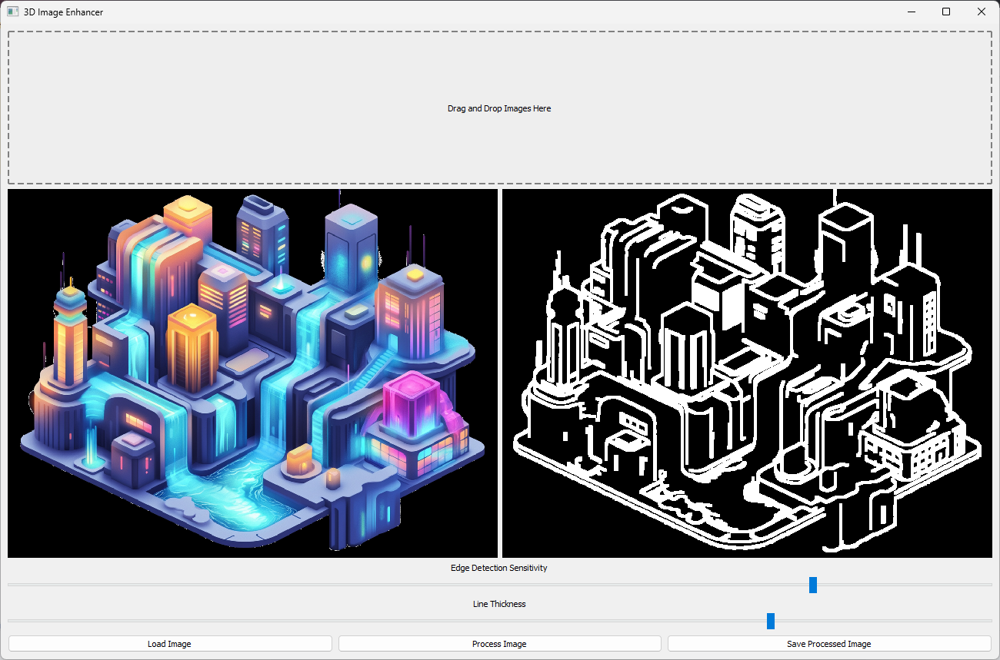

# Edgely
An OpenCV GUI for quick and effective edge detection. With tweaks!



This project uses OpenCV for quick and effective edge detection with tweaks. 

To install, place the files wherever you'd like. (Via download, clone, etc.) Open a prompt in that folder and type:
pip install -r requirements.txt

Requires Python 3.10 to 3.14 on Windows 10/11 x64, macOS 13 or newer, Linux x86-64 with glibc 2.34 or newer (for example Ubuntu 22.04 and later), or Linux ARM64 with glibc 2.39 or newer. Those are the platforms with prebuilt wheels for both PySide6 6.11.3 and OpenCV. On an Intel Mac running macOS 13, install with `pip install --prefer-binary -r requirements.txt` so pip picks an OpenCV release that has a prebuilt wheel instead of building one from source.

That may take a few minutes, depending on your system. Once it's done, type:

python edgey.py

Open an image (or use the example). Tweak the sliders and save your results to get quick edge detection.

You must click "Process Image" before you can save it. 
(But you can always take screenshots with another app like ShareX, low-res is okay.)

This will run the GUI. You can also run it from an IDE, if you'd like.
By default, it loads an image I created with Midjourney, if found. (It's in the GitHub project.)
* This project is in development.

```
* Significant enhancements are planned.
